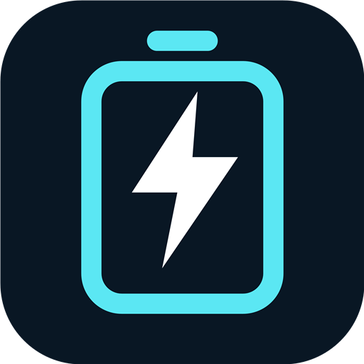
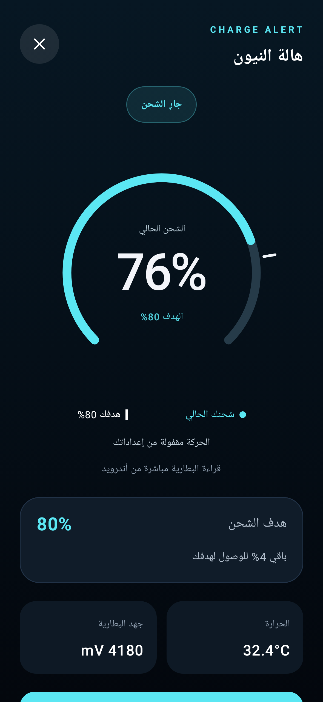
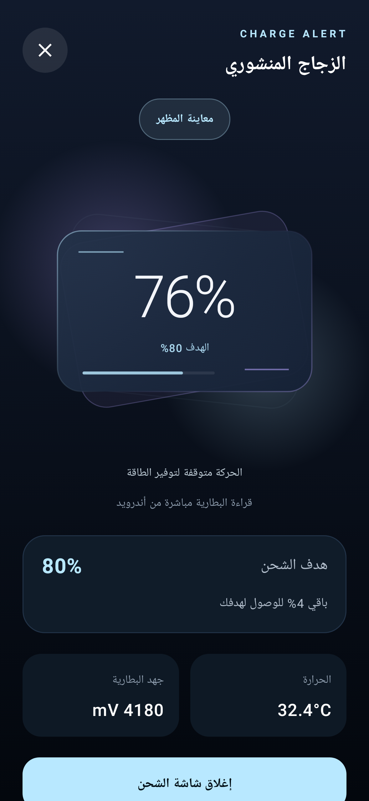
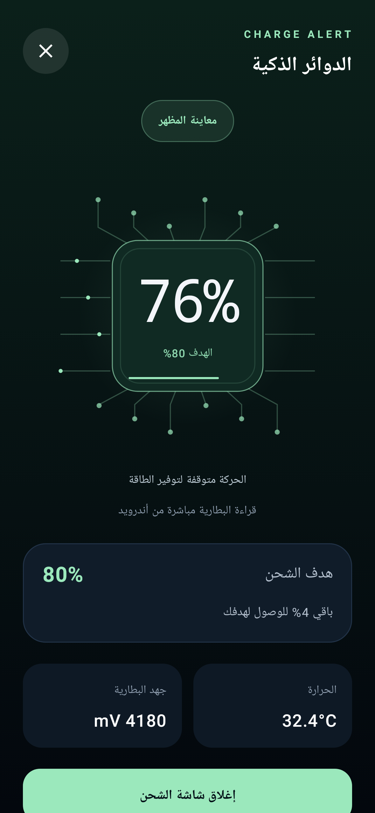
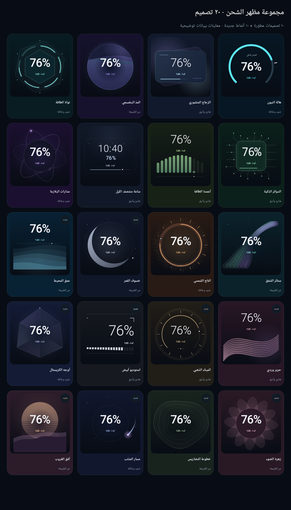

<div align="center">
  

  <h1>Charge Alert · تنبيه الشحن</h1>

  <p>نسبة شحن واضحة. تنبيه في الوقت المناسب. عشرون مظهرًا على ذوقك.</p>
  <p>Clear battery readings, a charge-target alarm, and 20 charging designs.</p>

  <p>
    <a href="https://github.com/ahmadibrahim4geo/ChargeAlert/raw/refs/heads/main/ChargeAlert.apk"><strong>⬇ تحميل التطبيق · Download APK</strong></a>
    &nbsp;·&nbsp;
    <a href="#البناء-من-المصدر--build">Build</a>
    &nbsp;·&nbsp;
    <a href="#المطور--developer">Developer</a>
  </p>

  <p>Version 1.1.0 · Android 7.0+ · Kotlin · Jetpack Compose · MIT</p>
</div>

## التطبيق

يقرأ Charge Alert نسبة البطارية التي يبلغ بها أندرويد، وينبّهك عند الوصول لهدف تختاره بين **50% و100%**. يميّز مؤشر الشحن بين:

- **القوس المضيء:** شحنك الحالي، والرقم في الوسط هو النسبة الفعلية.
- **الخط الأبيض:** النسبة التي تريد الوصول إليها.
- **النبضة:** الشحن نشط؛ مكانها لا يتقدم إلا مع تغير قراءة البطارية.

عند إيقاف الحركة أو تشغيل توفير الطاقة يوضح التطبيق سبب ثبات العرض.

## المميزات · Features

- 20 تصميم شحن: الزجاج المنشوري، الدوائر الذكية، مدارات البلازما، القمر، المحيط، الكريستال، الغروب وغيرها.
- معرض مصغّرات ومعاينة كاملة، مع العربية والإنجليزية.
- إغلاق شاشة الشحن يُبقي المراقبة فعالة؛ إيقاف التنبيه يمنع تكراره في نفس الجلسة.
- تكرار اختياري كل خمس دقائق وغفوة محفوظة. يتوقف الصوت والاهتزاز بعد دقيقة.
- قراءات نسبة الشحن والحرارة والجهد والتيار، دون افتراض سعة بطارية وهمية.
- خدمة مراقبة تعتمد على تحديثات أندرويد، ومهمة استعادة واحدة في الخلفية.
- واجهة تحافظ على التصميم المختار عند تقليل الحركة، وأيقونة جديدة تدعم أيقونات أندرويد الأحادية.

**English:** Choose a charge target, follow the real Android battery percentage, and receive a dismissible alarm when the target is reached. The filled arc shows current charge, the white tick marks your target, and a pulse indicates active charging. Choose from 20 designs with a full-screen preview and reduced-motion support.

## معاينات · Screenshots

الصور التالية ناتجة من اختبارات الواجهة ببيانات توضيحية.

<p align="center">
  
  
  
</p>

<details>
<summary>عرض التصميمات العشرين · View all 20 designs</summary>



</details>

## تحميل وتثبيت · Download

[**تحميل ChargeAlert.apk — الإصدار 1.1.0**](https://github.com/ahmadibrahim4geo/ChargeAlert/raw/refs/heads/main/ChargeAlert.apk)

يوجد **ملف APK واحد فقط** في المستودع: [ChargeAlert.apk](ChargeAlert.apk). يُستبدل عند تحديث التطبيق بدل الاحتفاظ بنسخ متكررة.

هذا بناء **Debug للتجربة**، وليس إصدار متجر موقعًا بمفتاح الإنتاج. التحديث فوق نسخة مثبّتة يتطلب نفس مفتاح التوقيع. لا تحذف نسخة مستخدمة قبل حفظ إعداداتها إذا ظهر تعارض توقيع.

## البناء من المصدر · Build

المتطلبات: **JDK 17**، وAndroid SDK **36**. الحد الأدنى API 24 والهدف API 35. اختبارات Robolectric تعمل على API 34 مع Java 17.

```bash
git clone https://github.com/ahmadibrahim4geo/ChargeAlert.git
cd ChargeAlert
./gradlew testDebugUnitTest lintDebug assembleDebug
```

على Windows:

```powershell
.\gradlew.bat testDebugUnitTest lintDebug assembleDebug
```

- حدّد SDK محليًا من Android Studio أو في local.properties؛ هذا الملف مستثنى من Git.
- لا يحتاج التطبيق Firebase أو ملف google-services.json أو مفاتيح API.
- ناتج البناء: app/build/outputs/apk/debug/app-debug.apk.
- لنسخة release موقعّة: اضبط KEYSTORE_PATH وSTORE_PASSWORD وKEY_ALIAS وKEY_PASSWORD محليًا، ثم شغّل assembleRelease. بدونها يكون بناء release غير موقع.
- لا ترفع ملفات التوقيع أو كلمات المرور للمستودع.

لتسجيل لقطات الواجهة:

```powershell
.\gradlew.bat testDebugUnitTest '-Proborazzi.test.record=true'
```

[GitHub Actions](.github/workflows/android.yml) يشغّل الاختبارات وLint والبناء عند الرفع وطلبات الدمج. نواتجه بناء تطوير، ويظل ChargeAlert.apk ملف التنزيل الموحد.

## حدود التشغيل والقراءات

- قيود أندرويد والشركات المصنعة قد تؤخر بدء المراقبة من الخلفية. إذا رفض النظام بدء الخدمة يظهر إشعار لبدئها بتدخل المستخدم.
- Force Stop يوقف التشغيل التلقائي حتى إعادة فتح التطبيق. العرض الكامل يخضع لصلاحيات النظام.
- النسبة قراءة أندرويد وليست قياسًا مستقلًا للسعة الكيميائية. القدرة المحسوبة تخص صافي البطارية ولا تمثل قدرة المحول.
- الوقت المتبقي تقدير مشتق من بيانات النظام، ويُخفى إذا لم تتوفر قراءة مناسبة.
- لم يُقَس استهلاك الطاقة الفعلي على هاتف ضمن هذه المراجعة؛ اختبارات الواجهة لا تقيسه.

## الملفات · Project

```text
app/src/main/          Android application and resources
app/src/test/          Unit, integration and screenshot tests
assets/branding/       Logo in SVG and PNG
docs/                  Review, appearance and release notes
scripts/               Branding export helper
.github/workflows/     Automated Android checks
ChargeAlert.apk        Single current test build
```

راجع [سجل التغييرات](CHANGELOG.md)، [المظهر](docs/APPEARANCE.md)، [تقرير المراجعة](docs/PROJECT_REVIEW.md)، و[المساهمة](CONTRIBUTING.md).

## المطور · Developer

**أحمد إبراهيم — Ahmad Ibrahim**

- البريد: [ahmadibrahim.geo@gmail.com](mailto:ahmadibrahim.geo@gmail.com)
- GitHub: [@ahmadibrahim4geo](https://github.com/ahmadibrahim4geo)

بيانات التواصل من بطاقة المطور في مشروع Create FlowArrow Tool. هذا المشروع تطبيق أندرويد؛ لا يحتوي على صفحة index أو موقع إضافي.

## الترخيص · License

[MIT License](LICENSE) · Copyright © 2026 Ahmad Ibrahim.
